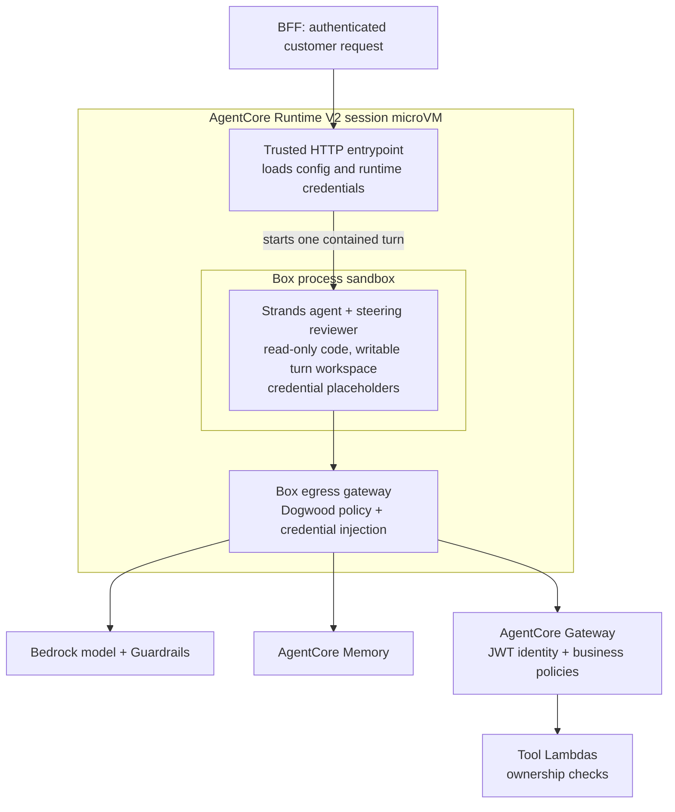

# AI Agent with Layered Safety Controls

AI agent reference architecture for AnyCompany Robotics customer service.
Demonstrates layered safety controls around an agent, including a Strands Box
sandbox inside Amazon Bedrock AgentCore Runtime's microVM.

> "You cannot prompt-engineer your way out of this. You fix it with architecture."

## Architecture

```
Customer → Cognito (OAuth) → API Gateway (REST) → BFF Lambda → AgentCore Runtime V2 (IAM)
                                                                      ↓
                                                          Strands Box sandbox
                                                          (one agent turn)
                                                                      ↓
                                                                Bedrock Guardrails
                                                                Steering Handler
                                                                      ↓
                                                          Box egress gateway
                                                          (policy + credentials)
                                                                      ↓
                                                                AgentCore Gateway (CUSTOM_JWT)
                                                                 ↓          ↓
                                                          Interceptor    Dogwood Policy
                                                          (JWT → ID)    (amount limits +
                                                                         tool sequencing)
                                                                 ↓
                                                            Tool Lambdas
                                                            (ownership checks)
                                                                 ↓
                                                          AgentCore Memory
```

## Safety Layers

| Layer | What it does | What it catches |
|-------|-------------|-----------------|
| Cognito + API Gateway | OAuth authentication at the edge | Unauthenticated access |
| WAF | Rate limiting, common exploits | DDoS, injection patterns |
| IAM Auth on Runtime | Users cannot bypass API Gateway to invoke the agent directly | Direct runtime access |
| AgentCore Runtime microVM | Isolates the hosted session from other sessions and the underlying infrastructure | Cross-session and host exposure |
| Strands Box inside Runtime | Restricts the agent process's files, writes, and network access; mediates credentials outside that process | Reads of operator credentials, writes outside scratch space, direct network access, and requests to unlisted destinations |
| Bedrock Guardrails | Content filtering, PII anonymization, topic denial | Prompt attacks, off-topic requests, credit card/SSN leaks |
| Steering Handler | Reviews agent responses before delivery (LLM-as-judge) | Unconfirmed promises, leaked system details, hallucinated contact info |
| Gateway Interceptor | Extracts `custom:customer_id` from JWT, injects into tool args | Customer ID spoofing — agent never controls identity |
| Dogwood Policy Engine | Declarative authorization on tool calls, including *temporal* rules over session history | Return labels for orders over $500 (must escalate to human); return labels without a prior successful eligibility check for the same order |
| Tool-Level Ownership | Each Lambda verifies `_authenticated_customer_id` against order data | Cross-customer data access |

## Why put Box inside a microVM?

The two layers protect different boundaries. AgentCore Runtime supplies the
outer microVM that hosts the session. Inside that microVM, the application still
has files, network access, and a runtime IAM role. Box lets you give the agent
process less access than the trusted application hosting it.



This is one microVM with an OS process sandbox inside it. Box does not start a
second microVM. On Linux it uses namespaces, filesystem mounts, and syscall
restrictions. The Box controller and egress gateway run outside the agent's
sandbox, within the same Runtime environment.

For example, a compromised agent process might try to read the runtime's AWS
credentials or send customer information to an unrelated website. The outer
microVM isolates that session, but does not by itself express this application's
allowed destinations. This sample gives the agent credential placeholders and
permits only its configured model, memory, and customer Gateway requests. Box
signs allowed AWS requests with the runtime role's temporary credentials and
substitutes the customer's JWT only on the configured Gateway route.

The existing authorization layers still matter. Box allowing an HTTP request to
the customer Gateway does not authorize a return. Gateway's Dogwood policies
check amounts and eligibility history, and the Lambda checks ownership against
the authenticated customer. Box's local policy and Gateway's policy engine have
separate histories. This sample keeps return sequencing in Gateway.

### When this extra layer helps

- **Agents with code, shell, file, or third-party tool access:** you want a
  compromised process to have a smaller set of files and destinations available.
- **Credentials shared by a trusted host and an agent:** the agent needs to use
  an API without being able to read and copy the underlying credential.
- **Sensitive data and narrow service access:** an endpoint allowlist limits
  where the process can send requests, even if it ignores an instruction.
- **A growing agent application:** establish the process boundary before adding
  broader execution tools. Review grants and policies whenever you add one.

This sample currently exposes narrow remote Lambda tools, so IAM, Gateway
authorization, and ownership checks already do much of the work. Box adds a
boundary around the agent process and its dependencies. For a small application
with no local execution or sensitive host files, that benefit may not justify
the extra packaging, startup time, and policy maintenance.

### What this implementation permits

[`agent/runtime_app.py`](agent/runtime_app.py) runs the HTTP service outside Box.
For every invocation it creates a private operator directory and a separate
scratch workspace, resolves the runtime role's temporary credentials, and starts
[`agent/boxed_worker.py`](agent/boxed_worker.py) inside Box. Real credentials and
the original customer JWT stay outside the worker's filesystem grants.

The worker gets read access to the bundled application and Python libraries,
write access only to its turn workspace, and the credential placeholders. Its
real CPython interpreter runs the existing agent and steering reviewer.
[`agent/box_policy.dw`](agent/box_policy.dw) permits the configured model's
Converse endpoints, requests under this deployment's memory ID, and the customer
Gateway's `/mcp` endpoint. Other destinations, direct network access, metadata
access, and Box-mediated shell or file operations have no permission.

Box startup or execution failure returns an error to the customer. There is no
automatic retry outside the sandbox. Each Box worker has a 75-second deadline; the
launcher terminates Box on timeout and removes the temporary turn directories
after it exits. Conversation memory remains in AgentCore Memory, and the same
Gateway policy session ID is forwarded across turns.

Worker OTEL export is disabled in this example because its network allowlist
does not include a telemetry collector. Runtime logs remain available. Box
decision records are written in the private turn state and removed during
cleanup; add a trusted export step if you need to retain them for audits.

There are limits to what these controls establish:

- Allowed endpoints can still receive sensitive data. An allowlist is not a
  content filter or a proof that data cannot be disclosed.
- The memory route covers the configured memory resource, not individual
  customer records. Box does not add per-actor memory authorization.
- Bedrock Guardrails and steering remain part of the application. This Box
  policy does not validate the model request body or force a compromised
  process to include a guardrail configuration.
- Direct reads within filesystem grants are OS-controlled; they do not create
  individual Dogwood decisions. Box policies apply at mediated boundaries.
- Box is in preview. Test the actual Runtime environment after changing Box,
  Python, dependencies, or platform settings. A local container test cannot
  establish the cloud service's namespace and mount permissions.

Upstream references: [Box cloud deployment requirements](https://github.com/strands-agents/box/blob/v0.2.2/docs/user/cloud-deployments.md),
[Box security model](https://github.com/strands-agents/box/blob/v0.2.2/docs/user/security.md),
and [AgentCore Runtime session isolation](https://docs.aws.amazon.com/bedrock-agentcore/latest/devguide/runtime-session-lifecycle.html).

## Structure

```
├── agent/                              # Strands agent (bundled + deployed via CDK)
│   ├── runtime_app.py                  # Trusted HTTP entrypoint and Box lifecycle
│   ├── boxed_worker.py                 # One agent turn inside Box
│   ├── box_policy.dw                   # Model, memory, and Gateway egress allowlist
│   ├── agent.py                        # Agent configuration + original local entrypoint
│   ├── steering.py                     # Response reviewer (SteeringHandler plugin, LLM-as-judge)
│   ├── steering_deterministic.py       # Example deterministic tool steering hook (rule-based)
│   ├── basic_agent.py                  # Minimal agent for demo (no guardrails/steering)
│   └── requirements.txt                # Dependencies (bundled via Docker at deploy time)
├── cdk/                                # CDK infrastructure (everything)
│   ├── app.py
│   ├── stacks/main_stack.py            # Full stack definition
│   ├── scripts/create_zip.py           # Agent code bundling script (used by Docker)
│   └── lambdas/
│       ├── bff/                        # BFF Lambda (IAM invoke, JWT forwarding)
│       ├── gateway_custom_resource/    # Bundled boto3 for policy engine operations
│       └── gateway_interceptor/        # JWT → customer_id injection
├── tool-lambdas/                       # Tool Lambdas (invoked via AgentCore Gateway)
│   ├── order-lookup/                   # Order details with ownership check
│   ├── warranty-lookup/                # Warranty status with ownership check
│   ├── return-label-generator/         # Generates return label, verifies amount + ownership
│   ├── check-return-eligibility/       # 30-day return window check with ownership
│   ├── company-policy-lookup/          # Bedrock Knowledge Base RAG lookup
│   └── create-case/                    # Escalation case creation (customer_id from JWT)
└── frontend/                           # Single-page app with Cognito auth
    ├── index.html
    └── server.py                       # Local dev server (port 8080)
```

## What CDK Deploys

Everything is managed by `cdk deploy` — a single command deploys the full stack:

- Cognito User Pool + App Client (OAuth authorization code flow)
- Regional REST API Gateway with Cognito authorizer, CORS, and a 90-second integration timeout
- BFF Lambda (forwards JWT in payload, invokes runtime via IAM)
- WAF (rate limiting + AWS managed rules)
- AgentCore Runtime V2 with Python 3.12 and Docker-bundled ARM64 agent code
- Strands Box v0.2.2 and matching helpers, verified against a pinned archive SHA-256 during bundling
- AgentCore Gateway with CUSTOM_JWT auth + interceptor (stable L2, auto-grants interceptor invoke)
- 6 Gateway Targets (`gateway.add_lambda_target` L2 methods)
- Policy Engine + 3 policies: two Cedar (L2 `Policy`) and one temporal Dogwood policy (L1 `CfnPolicy` with the `policy` definition — the L2 does not model temporal statements yet)
- Policy Engine → Gateway attachment (`policy_engine_configuration` on the Gateway L2, auto-grants evaluate permissions)
- Bedrock Guardrails (content filters, PII anonymization, topic denial)
- AgentCore Memory
- 6 Tool Lambdas with scoped IAM permissions
- Gateway Interceptor Lambda
- DynamoDB tables (Orders, Refunds, Cases)
- S3 buckets (return labels, transcripts)
- SSM parameters for agent config

## What's NOT in CDK (manual setup)

- Demo users in Cognito (`john.smith`, `sarah.johnson`) — create via CLI after deploy
- Sample data in DynamoDB (orders) — seed via CLI or script after deploy
- CloudWatch Transaction Search — one-time account-level enablement for observability

## Prerequisites

- AWS account with Bedrock model access enabled
- Docker running (required for agent code bundling)
- Python 3.12
- Node.js 22 or 24 (for CDK)
- CDK bootstrapped (`cdk bootstrap`)
- API Gateway's **Maximum integration timeout in milliseconds** quota of at
  least **90000** in the deployment region. Longer agent responses can exceed
  the default 29 seconds; an edge-optimized REST API cannot use this extended
  timeout.

Check the quota before deploying:

```bash
aws service-quotas get-service-quota --service-code apigateway \
  --quota-code L-E5AE38E3 --region us-east-1 --query 'Quota.Value'
```

If it is below 90000, request an increase and wait for approval:

```bash
aws service-quotas request-service-quota-increase --service-code apigateway \
  --quota-code L-E5AE38E3 --desired-value 90000 --region us-east-1
```

## Deploy

```bash
# Vendor dependencies into the tool Lambdas (fpdf2 for the label generator) — required, or
# return-label-generator fails at runtime with "No module named 'fpdf'"
./scripts/install-lambda-deps.sh

# Requires Docker running — bundles agent code with ARM64 dependencies in a container
cd cdk
pip install -r requirements.txt
cdk diff
cdk deploy
```

That's it. No separate `agentcore deploy` needed — CDK bundles the agent code with all dependencies using Docker and deploys it directly to the AgentCore Runtime via the L2 construct.

Review the diff before updating an existing deployment. Stop if it proposes
unintended bucket, table, or identity replacement. The Box change updates the
Runtime artifact, entrypoint, Python version, and platform version. It also
switches the REST API to Regional endpoints, extends its integration timeout,
and adjusts the BFF client timeout. It does not require deleting the existing stack.
Start a fresh frontend session after deploying to test the new Runtime revision.

### Verify Box

Run the launcher tests locally:

```bash
pip install -r agent/requirements.txt pytest
python -m pytest -q tests
```

On Linux ARM64 with Box's namespace and mount prerequisites, run the real
boundary probes against an extracted deployment archive:

```bash
python scripts/test-box-boundaries.py /path/to/extracted/agent-bundle
```

Preserve executable permissions when extracting, including the three Box
binaries and native Python extensions. The deployed launcher restores these
permissions in its private application copy.

The probes use fake credentials and check scratch writes, private-file denial,
application write denial, credential placeholders, direct network denial, and
unlisted egress denial. They make no model calls. Separately, use the deployed
frontend to test a normal order lookup, another customer's order, and return
eligibility across multiple turns. Successful packaging alone is not a live
deployment test.

Validation on November 10, 2026 used Box 0.2.2, Python 3.12, Strands 1.64.0,
and the AgentCore SDK 1.26.0. Ten launcher tests passed. All seven boundary
probes passed on local Linux ARM64 and inside a temporary Runtime V2
qualification deployment. Live checks covered a model response, memory recall
across fresh Box processes, an owned-order lookup, and denial of another
customer's order. The deployed application does not expose the qualification
probe endpoint.

The existing stack was also updated to Runtime V2, revision 3. An authenticated
request through Cognito, the public REST API, BFF, Box, and Gateway returned
HTTP 200 with the expected order details in 58 seconds, exercising the extended
API timeout. A follow-up through the same API denied the other customer's order.
Start a fresh session when checking a deployment. The first
request immediately after the API update still timed out at 29 seconds; the
later fresh-session request used the extended limit.

These are smoke tests of the listed paths, not exhaustive security or lifecycle
qualification. Cancellation, forced termination, concurrent requests, and
restored sessions still need dedicated tests before relying on those behaviors.

## Post-Deploy Setup

One script creates both demo users and seeds the sample orders with recent purchase
dates (the seeded orders must be inside the 30-day return window or the return demo
fails eligibility):

```bash
DEMO_PASSWORD='<PASSWORDHERE>' ./scripts/post-deploy-setup.sh
```

<details>
<summary>Manual post-deploy setup (equivalent to the script)</summary>

### Create demo users

```bash
POOL_ID=$(aws cloudformation describe-stacks --stack-name ProductionAgentGuardrailsStack \
  --query 'Stacks[0].Outputs[?OutputKey==`UserPoolId`].OutputValue' --output text)

aws cognito-idp admin-create-user --user-pool-id $POOL_ID --username john.smith \
  --user-attributes Name=email,Value=john.smith@example.com Name=custom:customer_id,Value=12345 \
  --temporary-password <PASSWORDHERE> --message-action SUPPRESS

aws cognito-idp admin-set-user-password --user-pool-id $POOL_ID --username john.smith \
  --password <PASSWORDHERE> --permanent

aws cognito-idp admin-create-user --user-pool-id $POOL_ID --username sarah.johnson \
  --user-attributes Name=email,Value=sarah.johnson@example.com Name=custom:customer_id,Value=67890 \
  --temporary-password <PASSWORDHERE> --message-action SUPPRESS

aws cognito-idp admin-set-user-password --user-pool-id $POOL_ID --username sarah.johnson \
  --password <PASSWORDHERE> --permanent
```

### Seed sample orders

```bash
aws dynamodb put-item --table-name Orders --item '{
  "orderId":{"N":"12345"},"customer_id":{"S":"12345"},"customerName":{"S":"John Smith"},
  "email":{"S":"john.smith@example.com"},"product":{"S":"RoboVac Pro X1"},
  "total":{"N":"249.99"},"purchaseDate":{"S":"2026-05-10"},
  "deliveryDate":{"S":"2026-05-13"},"shippingStatus":{"S":"delivered"},
  "warrantyEligible":{"BOOL":true}}'

aws dynamodb put-item --table-name Orders --item '{
  "orderId":{"N":"67890"},"customer_id":{"S":"67890"},"customerName":{"S":"Sarah Johnson"},
  "email":{"S":"sarah.johnson@example.com"},"product":{"S":"RoboVac Lite"},
  "total":{"N":"349.99"},"purchaseDate":{"S":"2026-05-05"},
  "deliveryDate":{"S":"2026-05-08"},"shippingStatus":{"S":"delivered"},
  "warrantyEligible":{"BOOL":false}}'

aws dynamodb put-item --table-name Orders --item '{
  "orderId":{"N":"99999"},"customer_id":{"S":"12345"},"customerName":{"S":"John Smith"},
  "email":{"S":"john.smith@example.com"},"product":{"S":"RoboVac Ultra Pro Max"},
  "total":{"N":"899.99"},"purchaseDate":{"S":"2026-05-10"},
  "deliveryDate":{"S":"2026-05-13"},"shippingStatus":{"S":"delivered"},
  "warrantyEligible":{"BOOL":true}}'
```

</details>

## Frontend

```bash
cd frontend
python server.py
# Open http://localhost:8080
```

## Key Design Decisions

- **IAM auth on runtime** — users cannot bypass API Gateway to call the agent directly
- **BFF Lambda** — invokes runtime via IAM SDK, forwards JWT in payload for downstream identity propagation
- **OAuth (CUSTOM_JWT) on the gateway** — policies evaluate the authenticated principal from the JWT
- **Single `cdk deploy`** — agent code bundled via Docker with ARM64 dependencies using the L2 construct
- **No direct refund tool** — returns generate a shipping label, refund is automatic on receipt
- **Cedar policy** blocks return labels for orders over $500 (escalated to human review). The `amount` is a real dollar value (e.g. `249.99`): the tool schema types it as `number`, and the policies compare it with Cedar's fixed-point `decimal` extension — `context.input.amount.lessThan(decimal("500.0"))` / `.greaterThanOrEqual(decimal("500.0"))`. Cedar/Dogwood has no float or decimal *literal*, so a bare `< 499.99` is rejected; the `decimal()` extension is the supported way to compare currency exactly
- **Dogwood temporal policy** permits a return label only after a successful `check-return-eligibility` call for the *same order* earlier in the session. The system prompt asks the agent to check eligibility first; this policy makes the ordering an architectural guarantee. Dogwood is a superset of Cedar — the existing Cedar policies run unchanged on the same engine
- **Policy session ID** — the agent sends `x-amzn-bedrock-agentcore-policy-session-id` on every gateway call; temporal policies evaluate against that session's history
- **Strands context management** — uses the default sliding-window conversation manager with AgentCore Memory. Strands 1.64's newer `context_manager` requires snapshot persistence, so this repository-based memory integration explicitly sets `context_manager=False`.
- **Customer identity flows from JWT** through the BFF → payload → agent → gateway interceptor — the agent never controls it
- **Tools are narrow and deterministic** — the tool defines the boundary, not the model
- **All IAM permissions scoped** to specific resources (model, guardrail, SSM namespace, gateway, memory)

## Steering Approaches

The repo includes two steering implementations:

- **`steering.py`** — LLM-as-judge (probabilistic). A second model evaluates every response against a review policy before it reaches the customer. Catches unconfirmed promises, leaked system details, over-promising on escalations, and hallucinated contact info.
- **`steering_deterministic.py`** — Rule-based deterministic hook. Example of using code-based checks (regex, keyword matching) for tool call validation without an additional model call. Faster and cheaper, but less flexible.

## Troubleshooting

### Agent returns errors / no logs in CloudWatch

Check Runtime and CloudWatch logs for initialization failures. The deployment
uses an ARM64 Python 3.12 bundle and Runtime V2. Box's main executable, both
helpers, and native Python extensions must retain executable permissions. The
launcher restores them before dropping root privileges, when applicable.

### Box refuses to start or a required request is denied

Check that Runtime reports platform V2, that the operator has a passwd entry,
and that the installed Box package is Linux ARM64. Namespace or mount denials
from the outer environment cannot be fixed by adding policy permits.

For egress denials, compare the requested host, method, and path with
`agent/box_policy.dw`. A new model or service needs an explicit policy change.
Keep required refusals in the test suite when broadening access.

### Docker auth required / Docker not running

The CDK bundle requires Docker with ARM64 support. Start Docker and retry the
CDK build. A plain `agentcore deploy` from `agent/` does not install the pinned
Box binaries or select this sample's trusted entrypoint.

### Policy CREATE_FAILED "Overly Restrictive"

The forbid policy must be created after the corresponding permit policies. The CDK stack has explicit `add_dependency` to enforce ordering. If deploying from scratch and this fails, delete the failed policies and redeploy.

### 409 ConflictException after changing a temporal policy

Adding or updating a temporal policy invalidates the engine's active policy sessions. The next request that reuses an old session fails with HTTP 409. Start a new session (logout/login in the frontend) and retry.

### Requests fail with a validation error about the policy session

Once the engine contains a temporal policy, every gateway request must carry the `x-amzn-bedrock-agentcore-policy-session-id` header. The agent sends it automatically (`agent/agent.py`); if you call the gateway directly (e.g. MCP inspector), add the header yourself.

### Return label denied even though the order is under $500

The temporal policy requires a *successful* `check-return-eligibility` call for the same order earlier in the same session, within the last hour. This is by design — it's the demo. Ask the agent to check eligibility first, or watch it recover by doing so itself.

### Gateway returns 403 on tool calls

Check the policies are all ACTIVE and the policy engine is attached to the gateway:
```bash
aws bedrock-agentcore-control get-gateway \
  --gateway-identifier <gateway-id> \
  --query 'policyEngineConfiguration'

aws bedrock-agentcore-control list-policies \
  --policy-engine-id <policy-engine-id> \
  --query 'policies[].{name:name,status:status}' --output table
```

### Memory poisoning (guardrail-blocked messages replay)

If a previous guardrail block gets stored in memory, it can poison subsequent turns in the same session. Fix: use a new session ID for each test (logout/login in the frontend). In production, implement selective memory writes.

### Fresh account deployment

1. `cdk bootstrap` (one-time)
2. `cdk deploy` (Docker must be running)
3. Run post-deploy setup (create demo users, seed DynamoDB)
4. Enable CloudWatch Transaction Search (one-time, for observability)

### Upgrading from the pre-Dogwood version

The move from L1/alpha constructs to the stable `aws_bedrockagentcore` L2s changes CloudFormation logical IDs, and several resources have fixed names — an in-place update will fail with name conflicts. Run `cdk destroy`, then `cdk deploy`, then re-run post-deploy setup. Temporal policies require a region that supports them (us-east-1, us-east-2, and us-west-2 all do).
